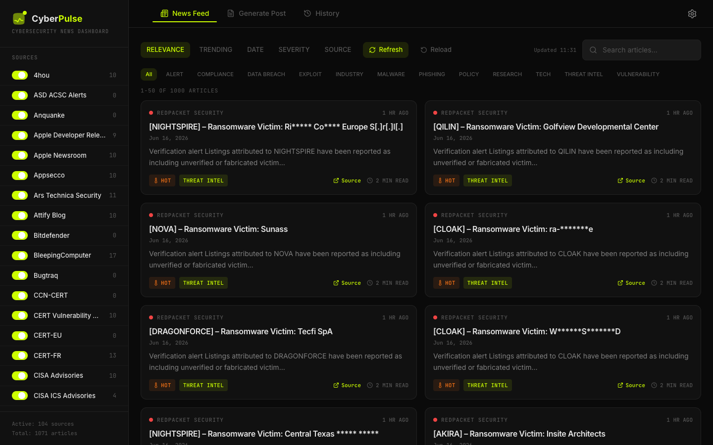
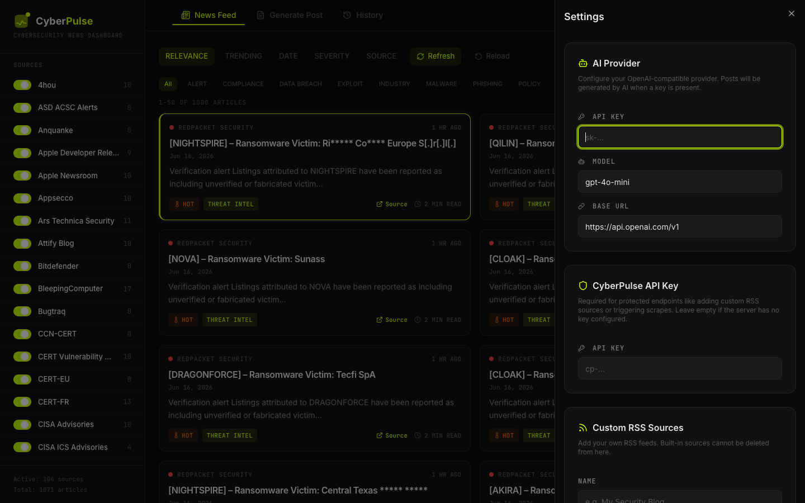
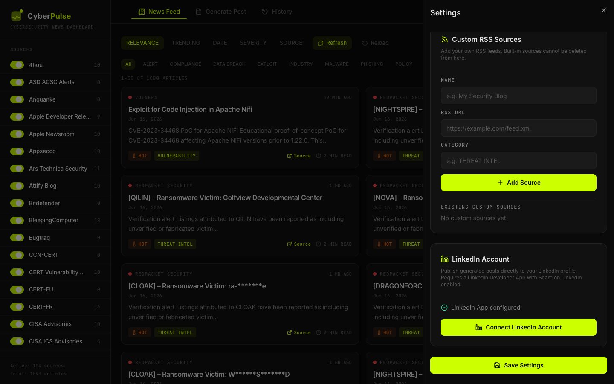
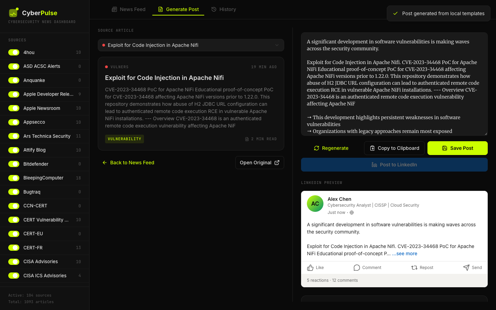
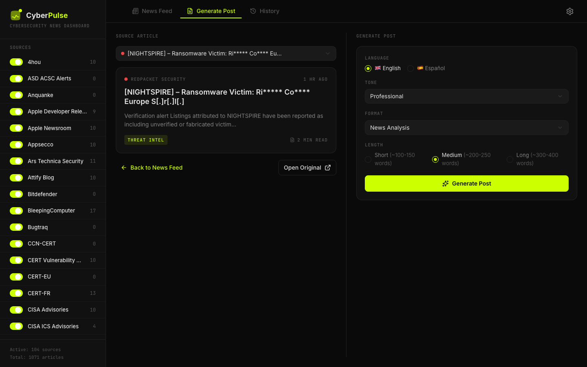
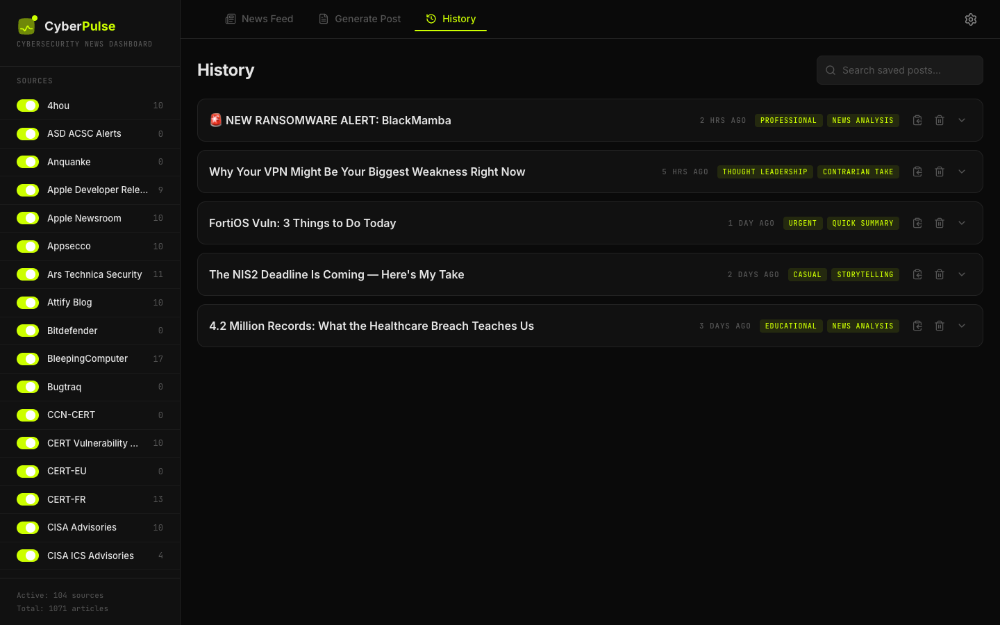
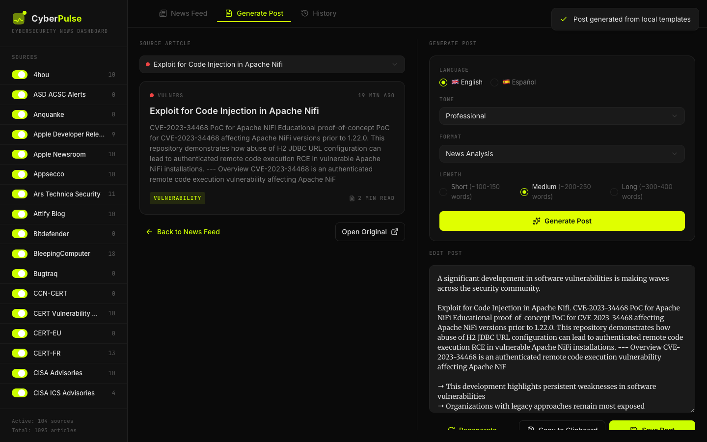

<p align="center">
  
</p>

<h1 align="center">CyberPulse</h1>

<p align="center">
  <strong>Cybersecurity news aggregator with a LinkedIn post generator.</strong><br>
  Consumes 100+ RSS feeds, classifies articles by severity/category, and generates publication-ready content.
</p>

<p align="center">
  <a href="README.es.md">🇪🇸 Leer en castellano</a>
</p>

<p align="center">
  
  
  
  
</p>

---

## Table of Contents

- [What is CyberPulse?](#what-is-cyberpulse)
- [Features](#features)
- [Quick start with Docker](#quick-start-with-docker)
- [Running without Docker](#running-without-docker)
- [How to add RSS sources](#how-to-add-rss-sources)
- [Post directly to LinkedIn](#post-directly-to-linkedin)
- [Built-in RSS sources](#built-in-rss-sources-118-sources-101-active)
- [Repository structure](#repository-structure)
- [Additional documentation](#additional-documentation)
- [Screenshots](#screenshots)
- [Deploying it publicly](#deploying-it-publicly)
- [Development](#development)
- [License](#license)

---

## What is CyberPulse?

CyberPulse is a productivity tool for cybersecurity professionals who need to stay current and share relevant content on LinkedIn.

<p align="center">
  
</p>

- **Collects** news from 100+ cybersecurity RSS feeds.
- **Classifies** each article by category (`VULNERABILITY`, `MALWARE`, `THREAT INTEL`, etc.) and severity (`critical`, `high`, `medium`, `low`).
- **Generates LinkedIn posts** in multiple formats and tones, with real bold text (HTML).
- **Publishes directly to LinkedIn** from the generator after OAuth authorization.
- **Supports AI generation**: connect your OpenAI-compatible provider (OpenAI, Groq, etc.) from the UI; falls back to local templates on failure.
- **Exposes a REST API and an MCP endpoint** for integration with AI agents like Hermes or OpenClaw.
- **Runs 100 % locally** with SQLite and Docker.

---

## Features

- 📰 **118 built-in RSS feeds**, 101 enabled by default.
- 🔥 **News feed** with filters by category, source, search, and sorting by date, severity or *trending*.
- 🕰️ **Reading windows**: last 24h, 7 days, 30 days, or everything. Source counts follow the window, and sources with nothing to show collapse out of the way.
- ✍️ **Post generator** with 5 tones, 6 formats, and EN/ES support.
- 🚀 **Post directly to LinkedIn** from the generator.
- 🕐 **History / saved posts** to keep your generated content.
- 🤖 **AI generation** configurable from the UI (API key, model, base URL).
- ⚙️ **Custom RSS sources** from the web interface.
- 🔑 **Optional API key** to protect sensitive endpoints.
- 🐳 **One-command Docker deploy**.
- 📊 **Stats, health checks, and logs** built in.

---

## Quick start with Docker

```bash
git clone https://github.com/safernandez666/CyberPulse.git
cd CyberPulse/app
docker compose up -d --build
```

Open http://localhost:3001 in your browser.

> After rebuilding, use **Ctrl + F5** or an incognito window to avoid the browser showing a cached frontend.

Useful commands:

```bash
# Check status
docker compose ps

# View logs
docker compose logs -f

# Force a manual scrape
curl -X POST http://localhost:3001/api/scrape

# List active sources
curl http://localhost:3001/api/sources

# Stop
docker compose down
```

---

## Running without Docker

Requirements: Node.js 20+ and npm 10+.

```bash
cd CyberPulse/app
npm install
npm run build
npm run server
```

- App: http://localhost:3001
- SQLite database is created at `./data/cyberpulse.db`.

---

## How to add RSS sources

There are three ways to add a new source.

### Option 1: From the web UI (recommended)

<p align="center">
  
</p>

1. Open CyberPulse and click **Settings** (gear icon).
2. Go to the **Custom RSS Sources** section.
3. Fill in:
   - **Name**: display name of the source.
   - **RSS feed URL**: e.g. `https://my-source.com/feed.xml`.
   - **Category**: one of the existing categories (see list below).
4. Click **Add source**.
5. If you protected the backend with `CYBERPULSE_API_KEY`, enter the **CyberPulse API Key** as well.

The new source is scraped in the next automatic cycle (every 15 minutes) or you can force it:

```bash
curl -X POST http://localhost:3001/api/scrape
```

### Option 2: Via the REST API

```bash
# Without API key
curl -X POST http://localhost:3001/api/sources \
  -H "Content-Type: application/json" \
  -d '{
    "name": "My New Source",
    "rssUrl": "https://my-source.com/feed.xml",
    "category": "THREAT INTEL"
  }'

# With API key configured
curl -X POST http://localhost:3001/api/sources \
  -H "Content-Type: application/json" \
  -H "X-API-Key: your-secret-key" \
  -d '{
    "name": "My New Source",
    "rssUrl": "https://my-source.com/feed.xml",
    "category": "THREAT INTEL"
  }'
```

### Option 3: Edit the code

1. Open `app/server/seeds.ts`.
2. Add an entry to the `RSS_SOURCES` array:

```typescript
{
  name: 'My New Source',
  rssUrl: 'https://my-source.com/feed.xml',
  category: 'THREAT INTEL'
}
```

3. Rebuild the container:

```bash
docker compose down
docker compose up -d --build
```

### Available categories

| Category | Typical use |
|----------|-------------|
| `VULNERABILITY` | Vulnerabilities, patches, advisories |
| `MALWARE` | Malware, ransomware, sample analysis |
| `THREAT INTEL` | Threat intelligence, actor reports |
| `DATA BREACH` | Data leaks, breaches |
| `PHISHING` | Phishing campaigns |
| `COMPLIANCE` | Regulatory compliance |
| `RESEARCH` | Security research |
| `PRIVACY` | Privacy |
| `POLICY` | Government policy |
| `INDUSTRY` | Industry news |
| `ALERT` | CERT/CISA/NCSC alerts |
| `AWARENESS` | Security awareness |
| `EXPLOIT` | Exploits, PoC, zero-days |
| `IOT` | IoT security |
| `TECH` | Relevant general tech |

---

## Post directly to LinkedIn

CyberPulse can publish generated posts straight to your personal LinkedIn feed. It uses LinkedIn's official OAuth 2.0 API, so you keep full control of your account.

<p align="center">
  
</p>

### 1. Create a LinkedIn Developer App

1. Go to the [LinkedIn Developer Portal](https://developer.linkedin.com/) and click **Create app**.
2. Fill in the required details:
   - **App name**: e.g. `CyberPulse`
   - **LinkedIn Page**: you must associate a LinkedIn Company Page. If you don't have one, create a minimal page first.
   - **Privacy policy URL**: your website or LinkedIn profile URL.
3. Under the **Products** tab, request:
   - **Share on LinkedIn** — instant approval.
   - **Sign In with LinkedIn using OpenID Connect** — instant approval.
4. Go to the **Auth** tab:
   - Copy your **Client ID** and **Client Secret**.
   - Under **OAuth 2.0 settings**, add this redirect URL:
     ```
     http://localhost:3001/api/linkedin/callback
     ```

### 2. Configure CyberPulse

1. Open CyberPulse and click **Settings**.
2. Scroll to the **LinkedIn Account** section.
3. Paste your **Client ID**, **Client Secret**, and the redirect URI (`http://localhost:3001/api/linkedin/callback`).
4. Click **Save LinkedIn App**.

### 3. Connect your account

1. In the same LinkedIn Account section, click **Connect LinkedIn Account**.
2. Authorize CyberPulse in the LinkedIn popup.
3. Once you see "LinkedIn Connected", you can close the popup.

### 4. Publish a post

1. Go to **Generate Post**, choose an article, and create your post.
2. Click **Post to LinkedIn**.
3. Review the text, choose **Public** or **Connections**, and click **Publish**.

<p align="center">
  
</p>

> **Note:** LinkedIn access tokens expire after approximately 60 days. If posting stops working, reconnect your account from Settings.

---

## Built-in RSS sources (118 sources, 101 active)

CyberPulse ships with 118 cybersecurity feeds, 101 of them enabled by default. This list is generated from `app/server/seeds.ts` — run `npm run docs:sources` after changing it.

### ALERT

| Source | RSS URL |
|--------|---------|
| CERT-EU | https://cert.europa.eu/publications/security-advisories-rss |
| CERT-FR | https://www.cert.ssi.gouv.fr/feed/ |
| INCIBE | https://www.incibe.es/incibe-cert/alerta-temprana/avisos/feed |
| JPCERT/CC | https://www.jpcert.or.jp/english/rss/jpcert-en.rdf |
| JPCERT/CC Blog | https://blogs.jpcert.or.jp/en/atom.xml |
| UK NCSC All | https://www.ncsc.gov.uk/api/1/services/v1/all-rss-feed.xml |
| UK NCSC News | https://www.ncsc.gov.uk/api/1/services/v1/news-rss-feed.xml |
| UK NCSC Reports | https://www.ncsc.gov.uk/api/1/services/v1/report-rss-feed.xml |

### COMPLIANCE

| Source | RSS URL |
|--------|---------|
| Dark Reading | https://www.darkreading.com/rss.xml |

### DATA BREACH

| Source | RSS URL |
|--------|---------|
| The Record | https://therecord.media/feed/ |
| Troy Hunt | https://www.troyhunt.com/rss/ |

### EXPLOIT

| Source | RSS URL |
|--------|---------|
| Exploit-DB | https://www.exploit-db.com/rss.xml |
| Sploitus | https://sploitus.com/rss |
| ZDI Blog | https://www.zerodayinitiative.com/blog?format=rss |
| ZDI Published | https://www.zerodayinitiative.com/rss/published/ |

### INDUSTRY

| Source | RSS URL |
|--------|---------|
| Cybersecurity Dive | https://www.cybersecuritydive.com/feeds/news/ |
| Infosecurity Magazine | http://www.infosecurity-magazine.com/rss/news/ |

### IOT

| Source | RSS URL |
|--------|---------|
| Attify Blog | https://blog.attify.com/rss/ |

### MALWARE

| Source | RSS URL |
|--------|---------|
| Bitdefender | https://www.bitdefender.com/blog/api/rss/hotforsecurity/ |
| Elastic Security Labs | https://www.elastic.co/security-labs/rss/feed.xml |
| Kaspersky Blog | https://www.kaspersky.com/blog/feed/ |
| Malwarebytes Labs | https://blog.malwarebytes.com/feed/ |
| Securelist | https://securelist.com/feed/ |
| SecurityWeek | https://feeds.feedburner.com/securityweek |
| SentinelOne | https://www.sentinelone.com/blog/feed/ |
| Sophos News | https://feeds.feedburner.com/sophos/dgdY |
| WeLiveSecurity | https://www.welivesecurity.com/en/rss/feed/ |

### PHISHING

| Source | RSS URL |
|--------|---------|
| Krebs on Security | https://krebsonsecurity.com/feed/ |

### POLICY

| Source | RSS URL |
|--------|---------|
| CyberScoop | https://cyberscoop.com/feed |

### RESEARCH

| Source | RSS URL |
|--------|---------|
| Ars Technica Security | https://arstechnica.com/security/feed/ |
| Fuzzing Labs | https://webassembly-security.com/feed/ |
| Google Bug Hunters | https://bughunters.google.com/feed/en |
| Google Online Security | https://feeds.feedburner.com/GoogleOnlineSecurityBlog |
| Google Project Zero | https://googleprojectzero.blogspot.com/feeds/posts/default?alt=rss |
| InfoSec Write-ups | https://infosecwriteups.com/feed |
| MaskRay | https://maskray.me/blog/atom.xml |
| NVISO Labs | https://blog.nviso.eu/feed/ |
| paper - Last paper | https://paper.seebug.org/rss/ |
| S3cur3Th1sSh1t | https://s3cur3th1ssh1t.github.io/feed.xml |
| STAR Labs | https://starlabs.sg/publications/index.xml |
| Tencent Xuanwu Lab | https://xlab.tencent.com/cn/feed/ |
| Trail of Bits | https://blog.trailofbits.com/feed/ |
| XPN InfoSec Blog | https://blog.xpnsec.com/rss/ |

### TECH

| Source | RSS URL |
|--------|---------|
| Hacker News Frontpage | https://hnrss.org/frontpage |
| Kali Linux | https://www.kali.org/rss.xml |

### THREAT INTEL

| Source | RSS URL |
|--------|---------|
| 4hou | https://www.4hou.com/feed |
| Anquanke | https://api.anquanke.com/data/v1/rss |
| Check Point Blog | https://blog.checkpoint.com/feed/ |
| Check Point Research | https://research.checkpoint.com/feed/ |
| Cisco Talos | https://feeds.feedburner.com/feedburner/Talos |
| CrowdStrike Blog | https://www.crowdstrike.com/blog/feed/ |
| Cybersecurity News | https://securityonline.info/feed/ |
| Darknet | http://feeds.feedburner.com/darknethackers |
| GuidePoint Security | https://www.guidepointsecurity.com/feed/ |
| HackerNews.cc | http://hackernews.cc/feed |
| Intelligence Online | https://feeds.feedburner.com/IntelligenceOnline |
| Palo Alto Networks | https://www.paloaltonetworks.com/blog/feed |
| Proofpoint Threat Insight | https://www.proofpoint.com/us/threat-insight-blog.xml |
| RedPacket Security | https://www.redpacketsecurity.com/feed/ |
| Risky Business | https://risky.biz/rss.xml |
| SANS ISC | https://isc.sans.edu/rssfeed.xml |
| SANS ISC Full | https://isc.sans.edu/rssfeed_full.xml |
| Schneier on Security | https://www.schneier.com/feed/atom/ |
| The DFIR Report | https://thedfirreport.com/feed/ |
| The Hacker News | https://feeds.feedburner.com/TheHackersNews |
| ThreatCluster | https://threatcluster.io/feed.xml |
| Threatpost | https://threatpost.com/feed/ |

### VULNERABILITY

| Source | RSS URL |
|--------|---------|
| Apple Developer Releases | https://developer.apple.com/news/releases/rss/releases.rss |
| Apple Newsroom | https://www.apple.com/newsroom/rss-feed.rss |
| BleepingComputer | https://www.bleepingcomputer.com/feed/ |
| Bugtraq | http://seclists.org/rss/bugtraq.rss |
| CERT Vulnerability Notes | http://www.kb.cert.org/vulfeed |
| CISA Advisories | https://www.cisa.gov/cybersecurity-advisories/all.xml |
| CISA ICS Advisories | https://www.cisa.gov/cybersecurity-advisories/ics-advisories.xml |
| CISA ICS Medical Advisories | https://www.cisa.gov/cybersecurity-advisories/ics-medical-advisories.xml |
| Cisco Security Blog | https://blogs.cisco.com/security/feed |
| CVEfeed.io | https://cvefeed.io/rssfeed/latest.xml |
| CXSecurity | https://cxsecurity.com/wlb/rss/all/ |
| Der Flounder | https://derflounder.wordpress.com/feed/ |
| FortiGuard PSIRT | https://www.fortiguard.com/rss/ir.xml |
| HackerOne Hacktivity | https://rss.ricterz.me/hacktivity |
| Intigriti | https://blog.intigriti.com/feed/ |
| Joseph Thacker | https://rez0.blog/feed.xml |
| Microsoft Security | https://www.microsoft.com/en-us/security/blog/feed/ |
| Microsoft Security Update Guide | https://api.msrc.microsoft.com/update-guide/rss |
| NSFocus | http://blog.nsfocus.net/feed/ |
| Palo Alto Security Advisories | https://security.paloaltonetworks.com/rss.xml |
| Pen Test Partners | https://www.pentestpartners.com/feed/ |
| PortSwigger Blog | https://portswigger.net/blog/rss |
| Praetorian | https://www.praetorian.com/blog/feed |
| Qualys Blog | https://blog.qualys.com/feed |
| Rapid7 Blog | https://blog.rapid7.com/rss/ |
| Rapid7 Emergent Threats | https://blog.rapid7.com/tag/emergent-threat-response/rss/ |
| RedesZone | https://www.redeszone.net/feed/ |
| Seebug | https://www.seebug.org/rss/new/ |
| Shubham Shah | https://shubs.io/rss/ |
| Telekom Security | https://github.security.telekom.com/atom.xml |
| Tenable Blog | https://www.tenable.com/blog/feed |
| Trickest CVE | https://github.com/trickest/cve/commits/main.atom |
| Vulners | https://vulners.com/rss.xml |
| Wallarm Lab | https://lab.wallarm.com/feed/ |

### Retired (17)

Verified unreachable, so they ship disabled rather than costing a request on every scrape. They stay listed in Settings and can be re-enabled at any time.

| Source | Reason |
|--------|--------|
| Appsecco | serves HTML, feed removed |
| ASD ACSC Alerts | connection refused |
| CCN-CERT | HTTP 403 (bot protection) |
| Cyber Kendra | HTTP 403 (bot protection) |
| CyberNews | HTTP 403 (bot protection) |
| ENISA | HTTP 404, no replacement found |
| FBI Cyber | HTTP 403 (bot protection) |
| Fortinet Blog | HTTP 404, no replacement found |
| Google TAG | HTTP 404, folded into blog.google |
| Mandiant | redirects to HTML on cloud.google.com |
| NSA Cybersecurity | HTTP 403 (bot protection) |
| OSI | WAF rejects the request |
| Packet Storm | TLS cert does not match hostname |
| Security Boulevard | HTTP 403 (bot protection) |
| tttang | connection refused |
| VulDB | HTTP 403 (bot protection) |
| Yassine Aboukir | malformed XML entity |

## Deploying it publicly

CyberPulse is a long-lived process with a SQLite file and a cron, so it needs
a container with a disk — **not** a serverless platform. Vercel and similar
cannot run it: the filesystem is ephemeral, so the database would be wiped,
and there is no process alive between requests for the scraper to run in.

Fly.io, Railway, Render or any small VPS all work. A `fly.toml` is included.

### What a public deployment changes

Reads stay open — anyone can browse the feed. Everything that writes, touches
LinkedIn, calls an AI provider or triggers a scrape requires the API key. You
enter it once under **Settings → CyberPulse API Key**; visitors without it
simply do not see those controls.

Two settings are not optional once the app is reachable from the internet:

```bash
CYBERPULSE_API_KEY=$(openssl rand -hex 32)   # without it, anyone could post to your LinkedIn
CYBERPULSE_SECRET=$(openssl rand -hex 32)    # encrypts the stored LinkedIn credentials
```

The server refuses to start with `NODE_ENV=production` and no API key. If you
genuinely want it open, set `CYBERPULSE_ALLOW_NO_AUTH=true` and understand
that LinkedIn publishing is then unauthenticated.

Keep `CYBERPULSE_SECRET` safe: lose it and the stored LinkedIn connection
cannot be decrypted, and you will have to disconnect and reconnect.

### Fly.io

```bash
cd app
fly launch --no-deploy --copy-config
fly volumes create cyberpulse_data --size 1 --region eze
fly secrets set CYBERPULSE_API_KEY=$(openssl rand -hex 32) \
                CYBERPULSE_SECRET=$(openssl rand -hex 32)
fly deploy
```

The volume is what makes the database survive a deploy, and
`auto_stop_machines = false` is what keeps the scraper running — a stopped
machine silently stops collecting.

Set the LinkedIn redirect URI to `https://<your-app>/api/linkedin/callback`
in both the LinkedIn Developer console and `LINKEDIN_REDIRECT_URI`.

### Hardening already in place

- Non-root container (uid 1000), no compiler or shell tooling in the runtime image.
- `helmet` security headers including a content security policy.
- Rate limiting: 300 reads and 20 writes per minute per IP.
- CORS restricted to same-origin unless `CYBERPULSE_CORS_ORIGINS` says otherwise.
- The AI proxy only reaches an allowlist of provider hosts over https.

---

## Development

```bash
cd app
npm install
npm run dev          # Vite on :3000 + API on :3001
npm test             # 37 unit tests (vitest)
npm run build        # typecheck + production bundle
npm run lint
npm run docs:sources # regenerate the source tables in both READMEs from seeds.ts
```

The tests cover the scraper's date handling, the feed-window filtering, and
the security helpers (HTML escaping, the same-origin check, the AI host
allowlist). CI runs the build, the tests and `npm audit --omit=dev` on every
push and pull request.

After editing `app/server/seeds.ts`, run `npm run docs:sources` so the tables
in this file stay in step with what actually ships.

---

## Repository structure

```
CyberPulse/
├── app/                  # Main application (React + Express + SQLite)
│   ├── src/              # Frontend
│   ├── server/           # Backend and scraper
│   ├── public/           # Logo and static assets
│   ├── docker-compose.yml
│   ├── Dockerfile
│   ├── API.md            # Full API documentation
│   └── DOCKER.md         # Detailed Docker guide
├── vscode-extension/     # VS Code extension for CyberPulse
├── research/             # Architecture and content strategy docs
└── README.md             # This file
```

---

## Screenshots

A few captures of CyberPulse in action. Click any image to view it full size.

| News Feed | Generate Post | History | Settings |
|-----------|---------------|---------|----------|
| <a href=".github/screenshots/01-news-feed.png"></a> | <a href=".github/screenshots/02-generate-post.png"></a> | <a href=".github/screenshots/03-history.png"></a> | <a href=".github/screenshots/04-settings.png"></a> |

| LinkedIn Settings | LinkedIn Button | LinkedIn Publish |
|-------------------|-----------------|------------------|
| <a href=".github/screenshots/05-linkedin-settings.png"></a> | <a href=".github/screenshots/06-linkedin-button.png"></a> | <a href=".github/screenshots/07-linkedin-publish-dialog.png"></a> |

---

## Additional documentation

- [`app/API.md`](app/API.md) – Complete REST and MCP endpoints.
- [`app/DOCKER.md`](app/DOCKER.md) – Advanced Docker guide.

---

## Environment variables

| Variable | Default | Description |
|----------|---------|-------------|
| `PORT` | `3001` | Server port |
| `CYBERPULSE_API_KEY` | `null` | Optional API key to protect sensitive endpoints |
| `LINKEDIN_CLIENT_ID` | `null` | LinkedIn Developer App Client ID (optional — can also be set in the GUI) |
| `LINKEDIN_CLIENT_SECRET` | `null` | LinkedIn Developer App Client Secret (optional — can also be set in the GUI) |
| `LINKEDIN_REDIRECT_URI` | `http://localhost:3001/api/linkedin/callback` | LinkedIn OAuth redirect URI |
| `SCRAPE_CRON` | `*/15 * * * *` | RSS scraping interval (cron syntax) |
| `CYBERPULSE_SCRAPE_CONCURRENCY` | `8` | Feeds fetched in parallel. A full scrape of 100+ feeds takes ~20 s |
| `CYBERPULSE_CORS_ORIGINS` | same-origin only | Comma-separated extra browser origins allowed to call the API. `*` disables the check — only sensible behind your own auth |
| `CYBERPULSE_AI_HOSTS` | *(see below)* | Comma-separated extra hosts the AI proxy may call. Defaults cover OpenAI, Groq, Anthropic, Mistral, Together, DeepSeek, OpenRouter and Google |
| `CYBERPULSE_MAX_NEWS` | `20000` | Hard ceiling on `limit` for `GET /api/news` |
| `CYBERPULSE_SECRET` | `null` | Encrypts the LinkedIn token and client secret at rest (AES-256-GCM). Without it they are stored in clear text. Generate with `openssl rand -hex 32` |
| `CYBERPULSE_ALLOW_NO_AUTH` | `false` | Lets the server start in production without an API key. Every write endpoint is then unauthenticated |
| `CYBERPULSE_RATE_READ` | `300` | Read requests allowed per minute per IP |
| `CYBERPULSE_RATE_WRITE` | `20` | Write requests allowed per minute per IP |
| `TRUST_PROXY` | `null` | Set to `1` behind a reverse proxy so rate limiting sees the real client IP |
| `NODE_ENV` | `production` | Node environment |

---

## License

MIT © Santiago Fernández
